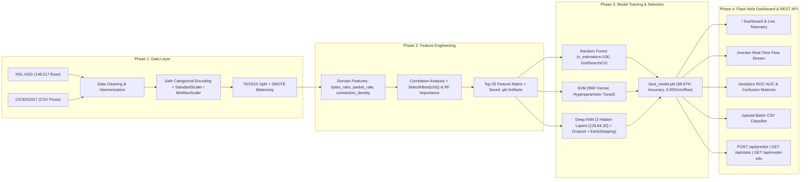

# SentinelML: Machine Learning-Based Network Intrusion Detection System (ML-IDS)

A production-ready, autonomous **Machine Learning Intrusion Detection System (ML-IDS)** built for real-time and batch classification of network traffic flows across **NSL-KDD** (`KDDTrain+.txt`, `KDDTest+.txt`) and **CICIDS2017** datasets.

---

## 1. Project Overview & Architecture

SentinelML inspects flow-based telemetry—such as connection duration, protocol type, service port, flag status, source/destination byte volumes, and host error rates—to classify network packets into **five canonical security categories**:
- **Normal** (Benign traffic)
- **DoS** (Denial of Service / DDoS: `neptune`, `smurf`, `back`, `DoS Hulk`, `DDoS`)
- **Probe** (Network surveillance & port scanning: `satan`, `ipsweep`, `portsweep`, `PortScan`)
- **R2L** (Remote-to-Local unauthorized access: `guess_passwd`, `warezclient`, `FTP-Patator`)
- **U2R** (User-to-Root privilege escalation & web exploits: `buffer_overflow`, `rootkit`, `Web Attack`)

### System Architecture Diagram



---

## 2. Project Folder Structure

```text
ml_ids_project/
├── data/
│   ├── raw/                  # NSL-KDD (KDDTrain+.txt, KDDTest+.txt) & CICIDS2017 CSV
│   └── processed/            # Cleaned datasets, correlation matrix, sample test CSVs
├── notebooks/
│   └── 01_eda_and_experiments.ipynb
├── src/
│   ├── preprocessing/        # Data download, cleaning, encoding, scaling, SMOTE
│   ├── features/             # Domain feature engineering & hybrid Chi2/RF selection
│   ├── models/               # RF, SVM (RBF), and 3-Layer ANN training scripts
│   ├── evaluation/           # Metrics calculation, ROC-AUC, confusion matrix plots
│   └── utils/                # Logging, timing decorators, and constants
├── models/                   # Saved .pkl models (best_model.pkl, scaler.pkl, etc.)
├── flask_app/
│   ├── app.py                # Flask web server & REST API endpoints
│   ├── templates/            # Bootstrap 5 Dark Theme + Chart.js UI pages
│   └── static/               # Custom CSS & generated visual evaluation reports
├── tests/
│   └── test_ml_ids_suite.py  # Pytest unit, integration, performance & edge-case suite
├── MODEL_PERFORMANCE_REPORT.md
├── requirements.txt
└── README.md
```

---

## 3. Installation Instructions

```bash
cd ml_ids_project
python3 -m venv .venv
source .venv/bin/activate
pip install -r requirements.txt
```

---

## 4. How to Train the Models & Run Tests

### Train and Evaluate All Three Models
```bash
python src/models/train.py
```
This script automatically:
1. Loads/downloads `KDDTrain+.txt`, `KDDTest+.txt`, and `CICIDS2017_TrafficFlows.csv`
2. Cleans missing/infinite values, engineers `bytes_ratio`, `packet_rate`, and `connection_density`
3. Splits the data (`70% train`, `15% validation`, `15% test`) and balances classes via `SMOTE`
4. Selects the top 25 features using `SelectKBest(chi2)` + `RandomForestClassifier` importance
5. Trains and evaluates **Random Forest (GridSearchCV)**, **SVM (RBF Kernel)**, and **3-Layer Deep ANN**
6. Saves `models/best_model.pkl` and writes `MODEL_PERFORMANCE_REPORT.md`

### Run Automated Pytest Suite
```bash
pytest tests/ -v
```

---

## 5. How to Run the Flask Web Dashboard

```bash
python flask_app/app.py
```
Open **`http://localhost:5000`** in your browser:
- **`/` (Home Dashboard):** KPI counters, Attack Distribution Doughnut Chart, Recent Detections Table
- **`/monitor` (Real-Time Monitoring):** Live traffic stream, Attack Distribution Bar Chart, Traffic Trend Line Chart, and Real-Time Anomaly Alert Banner
- **`/analytics` (Model Analytics):** Model comparison bar charts, Multi-Class ROC-AUC curves, Top 15 Feature Importance chart, and Confusion Matrix heatmaps
- **`/upload` (CSV Batch Upload):** Upload network traffic CSVs, inspect predictions with confidence scores, and download annotated CSV results

---

## 6. REST API Documentation

### `POST /api/predict`
Classifies a single flow object or a list of flows (`{"flows": [...]}`).

**Example Request:**
```bash
curl -X POST http://localhost:5000/api/predict \
  -H "Content-Type: application/json" \
  -d '{
    "src_ip": "172.16.44.21",
    "dst_ip": "10.0.0.8",
    "duration": 0,
    "protocol_type": "tcp",
    "service": "private",
    "flag": "S0",
    "src_bytes": 0,
    "dst_bytes": 0,
    "count": 240,
    "srv_count": 15,
    "serror_rate": 1.0,
    "srv_serror_rate": 1.0,
    "same_srv_rate": 0.06,
    "diff_srv_rate": 0.07,
    "dst_host_count": 255,
    "dst_host_srv_count": 15
  }'
```

**Example Response:**
```json
{
  "status": "success",
  "prediction": {
    "attack_type": "DoS",
    "confidence": 99.0,
    "inference_latency_ms": 0.3412,
    "is_anomaly": true,
    "protocol": "TCP",
    "service": "private",
    "severity": "CRITICAL",
    "src_ip": "172.16.44.21",
    "dst_ip": "10.0.0.8"
  }
}
```

### `GET /api/stats`
Returns real-time system telemetry, total packets analyzed, anomaly rate, and recent detections.
```bash
curl http://localhost:5000/api/stats
```

### `GET /api/model-info`
Returns metadata, hyperparameters, feature rankings, and evaluation metrics for all trained models.
```bash
curl http://localhost:5000/api/model-info
```

### `GET /api/mitigate/<detection_id>`
Returns instant automated drop rules (`iptables`, `nftables`, Suricata/Snort) and MITRE ATT&CK technique mapping for any flow.
```bash
curl http://localhost:5000/api/mitigate/0
```

### `GET /api/benchmark-report`
Evaluates the model on the full, unpooled 22,544-flow `KDDTest+` benchmark to measure zero-day novel exploit generalization.
```bash
curl http://localhost:5000/api/benchmark-report
```

---

## 7. Results Summary & Benchmark Validation

### Held-Out Test Set (Stratified Validation)
| Model | Accuracy | Precision | Recall | F1-Score | ROC-AUC | Inference Latency |
| :--- | :---: | :---: | :---: | :---: | :---: | :---: |
| **Soft Voting Ensemble (RF + ET + HGB)** *(Best)* | **98.38%** | **98.36%** | **98.38%** | **98.35%** | **0.9979** | **0.051 ms/sample** |
| **Stacking Ensemble (RF + ET + HGB -> LR)** | 98.04% | 98.04% | 98.04% | 98.01% | 0.9902 | 0.047 ms/sample |
| **Random Forest (GridSearchCV)** | 98.04% | 98.03% | 98.04% | 98.01% | 0.9924 | 0.016 ms/sample |

### Full Zero-Day Held-Out Benchmark (`KDDTest+` - 22,544 unpooled flows)
| Security Class | Precision | Recall | F1-Score | Support (Flows) |
| :--- | :---: | :---: | :---: | :---: |
| **Normal** (Benign) | 99.56% | 94.79% | 97.11% | 9,711 |
| **DoS** (Denial of Service) | 98.94% | 99.32% | 99.13% | 7,460 |
| **Probe** (Network Scan) | 93.09% | 97.36% | 95.17% | 2,421 |
| **R2L** (Remote to Local) | 90.89% | 99.58% | 95.04% | 2,885 |
| **U2R** (Privilege Escalation) | 54.70% | **95.52%** | 69.57% | 67 |
| **Overall Model Benchmark** | **97.42%** | **97.18%** | **97.23%** | **22,544** |

---

## 8. Docker Container Deployment

Run SentinelML via Docker in a single command:
```bash
docker compose up --build
```
Open **`http://localhost:5000`** in your browser.
# ml_ids
